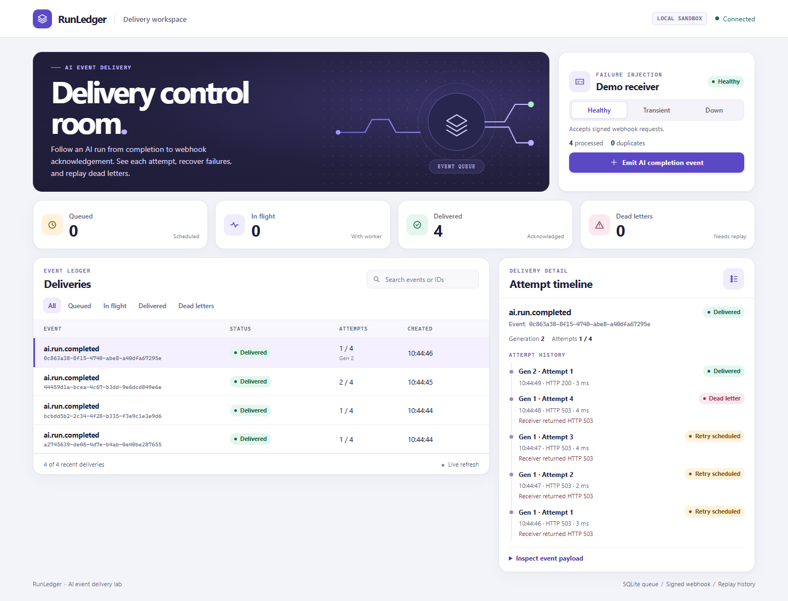

# Yiyu Zhu · 朱奕宇

**Full-stack software engineering · AI application integration · reliable APIs**

I build and verify the path between an AI or business event and the application that acts on it. My portfolio includes a durable callback queue, an order reconciliation workbench, and an AI review flow with explicit decision boundaries.

[English résumé](resume/Resume_EN.md) · [中文简历](resume/Resume_ZH.md) · [PDF (EN)](resume/Resume_EN.pdf) · [PDF（中文）](resume/Resume_ZH.pdf) · [Word (EN)](resume/Resume_EN.docx) · [Word（中文）](resume/Resume_ZH.docx) · [Email](mailto:zhuyy8612@gmail.com)

## Featured project · RunLedger

**An AI job finishes while its callback receiver is down. What happens to the result?**

RunLedger persists the event and the delivery in one SQLite transaction. Workers record a lease and attempt before making the signed HTTP request. The console exposes each failure and retry. An operator can replay a dead letter after recovery and compare both generations under the same delivery ID.

| Reproducible case | Observed result |
| --- | --- |
| 200 local submissions, including 100 repeats | 100 delivery IDs, 100 successful deliveries and 100 receiver records |
| Two worker processes compete for one task | One claim. After the winning process is killed, a fresh connection reclaims the same ID under a new token. |
| Receiver commits while the sender misses the acknowledgment | Two HTTP deliveries produce one inbox write. |
| A 503 response exhausts the retry budget | Replay succeeds after recovery and keeps the previous attempts visible. |

The console searches the complete ledger with cursor pagination. Read-transaction metrics expose due work, queue age, scheduled tasks, expired leases and historical attempt outcomes. On-demand p50/p95/p99 measurements separate attempt duration, original event age and successful replay-generation time, with sample and invalid-clock counts. **40 RunLedger scenarios** exercise these boundaries and HTTP delivery behavior.

WAL-aware online backups pin a committed read snapshot while writers continue. Restore creates a fresh database and preserves leases, idempotency, replay history and inbox receipts; integrity checks and atomic no-overwrite publication guard the recovery boundary. A read-only retention plan measures old successful generations while preserving idempotency and inbox state.

[Source, run instructions and design notes](runledger)

## Selected engineering work

| Project | Design and verification |
| --- | --- |
| [OrderCheck](https://github.com/zhuyy86/ordercheck) | Preserves decimal money values and isolates entire groups of conflicting records. One processing core powers the CLI and Streamlit review screen. 78 tests and a seven-sheet audit workbook. CLI reports publish complete staged files exclusively, with failure/retry and competing-writer coverage. KPI JSON replaces the final file only after a complete staged write and sync. |
| [LeadReview](README.md#lead-intake--decision-workflow) | Separates model extraction from deterministic scoring and human approval. The workflow records why a lead was scored and distinguishes a proposed action from the action eligible to execute. |
| [API Contract Lab](tools/API_CONTRACT_LAB.md) | Reproduces malformed JSON, incomplete server-sent event streams, and timeouts against a local HTTP fixture. The test runner records which part of the response contract failed. |
| [PriceWatch](https://github.com/zhuyy86/pricewatch) | Serializes snapshot comparison and commit in SQLite. Validates complete alert policies before scraping or output. 53 tests cover snapshots, rollback, alerts and CLI failures. |

## Professional experience

**China Telecom · Innovation Product Operations Center**

Reproduce integration issues across input, platform configuration, inference output and event delivery. Turn observations into actionable configuration checks, failure reproductions and retest records.

## 中文简介

主打作品 RunLedger 把 AI 完成事件的入队、重试、死信与人工重放连成一个可操作的控制台。一次本地并发验证提交 200 次请求，其中 100 次重复，最终 100 条不同事件全部投递。独立进程故障测试复现了 worker 终止后的租约接管，HTTP 测试验证了回执丢失后接收端只落库一次。项目源码、复现命令和测试均在仓库中。

接受远程开发和系统集成合作，每周可投入约 20 小时。中英文简历与联系邮箱见页首。
