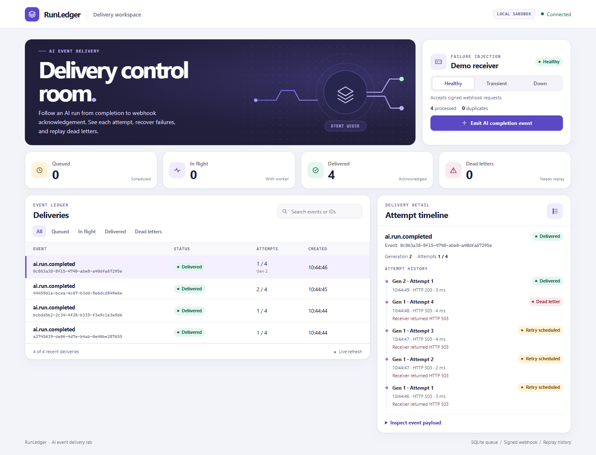
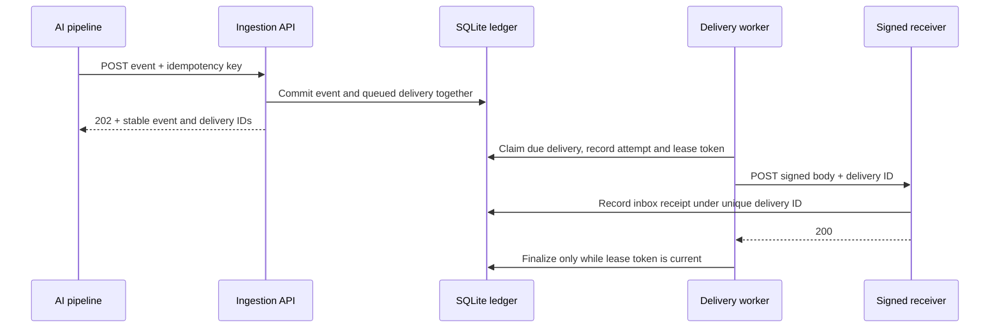

# RunLedger · AI event delivery console

An AI pipeline has finished. Its callback endpoint is returning 503. RunLedger stores the completion event, schedules delivery, records each attempt and lets an operator replay the dead letter after the endpoint recovers.



## Run the failure demo

From this directory, with Node.js 24 installed:

```sh
node server.mjs
```

Open [127.0.0.1:4327](http://127.0.0.1:4327). Set the receiver to **Down**, then select **Emit AI completion event**. Open the delivery and watch four attempts end in a dead letter. Switch the receiver to **Healthy** and choose **Replay delivery**. The same delivery ID succeeds in generation 2. Generation 1 remains in the timeline. **Transient** mode returns one 503 per delivery and then accepts a retry.

## How a delivery survives failure



| Boundary | Design decision |
| --- | --- |
| Producer → ledger | SQLite WAL and `BEGIN IMMEDIATE` make event creation and queue insertion one commit. A repeated key with an equivalent canonical payload returns the original IDs. A changed payload under the same key returns HTTP 409. |
| Ledger → worker | Claim and attempt creation share a short transaction. Network I/O happens after commit. An expired lease becomes an audit row and releases the job for a new attempt if its budget remains. A stale token cannot finalize the new attempt. |
| Worker → receiver | The raw request body, stable delivery ID and timestamp are signed with HMAC-SHA256. The receiver checks the signature and five-minute timestamp window before recording a receipt under a unique ID. If the receiver commits and its acknowledgment is lost, a retry can reach it again with the same ID. Its inbox suppresses the duplicate effect. |
| Retry → operator | Timeouts, connection errors, 408, 429 and 5xx use exponential backoff with equal jitter, capped at 10 seconds. `Retry-After` is a separate minimum wait, accepted as seconds or an HTTP date; it can extend the wait up to 24 hours. Longer values enter dead letter for operator review instead of retrying early. Terminal errors and exhausted budgets also enter the dead-letter view. Replay increments the generation and leaves old attempts intact. |

The console and demo receiver bind to loopback. SQLite stores the queue, lease, attempt history and receiver inbox on one machine. Search and status filtering run against the whole ledger. Pages use a `(created_at, id)` cursor, including a deterministic tie-break for simultaneous submissions. Each response reads global counts, filtered counts and its page in one SQLite read transaction. The demo persists under `data/runledger.sqlite` by default.

## Reproduce the evidence

```sh
node --test
node verify-workload.mjs
```

- **26 passing scenarios** cover idempotency conflicts, lease fencing, replay history, inbox persistence, a hard-killed worker process, live HTTP recovery, raw-body signature checks, a lost acknowledgment, full-ledger queries, retry scheduling, queue measurements and real HTTP transport boundaries.
- **200 local HTTP submissions** ran in batches of 20 with two worker loops. The 100 repeated submissions returned their existing IDs. All 100 distinct events were delivered and recorded by the receiver.
- **A real process exit** leaves the winning claim in SQLite. A fresh connection reclaims it under a different token and rejects the stale completion.
- **A lost acknowledgment** produces two HTTP attempts and one committed inbox record. The second receipt increments the duplicate counter.
- **An old dead letter** remains discoverable behind 130 newer records. Cursor tests traverse tied timestamps exactly once while a newer event is inserted.
- **A real HTTP 429 with `Retry-After: 120`** schedules at least 120 seconds into the future while another queued delivery succeeds. The test inspects the persisted schedule without waiting two minutes.

The verification script uses a temporary database. The latest local run used Linux and Node.js 24.22.1. The [CI workflow](../.github/workflows/verify.yml) runs the same checks on Linux and Windows with Node.js 24; inspect its run result separately from local verification.

For the browser regression, run `npm ci` and `npx playwright install chromium` from the repository root, then `node scripts/verify_runledger_browser.mjs`. It checks pagination over 131 deliveries, an old dead letter, out-of-order search responses, replay history, empty results and a 390-pixel viewport. `CHROMIUM_EXECUTABLE` can select an installed browser. The CI browser job runs this check separately from the dependency-free Node.js suites.

## API

| Endpoint | Purpose |
| --- | --- |
| `POST /api/events` | Submit `{"type":"ai.run.completed","payload":{"run":"r-1"}}` with a unique `Idempotency-Key`. |
| `GET /api/overview` | Read global queue counts, filtered delivery pages and receiver counters. Supports `status`, `q`, `limit` and `cursor`. |
| `GET /api/deliveries/:id` | Read the event and attempt history. |
| `POST /api/deliveries/:id/replay` | Start a new attempt generation for a dead delivery. |

`status` defaults to `all` and accepts `queued`, `in_flight`, `delivered` or `dead`. `q` is a literal substring of event type, event ID or delivery ID (ASCII case-insensitive, up to 128 characters). `limit` defaults to 25 and accepts 1–100. The response's `page` contains `matching`, `limit`, `has_more` and `next_cursor`.

Pass `next_cursor` unchanged with the same status, query and limit. Changing those parameters starts a new traversal; incompatible or malformed cursors return HTTP 400. Newer insertions do not shift the next page. This is a live view: status changes can move deliveries into or out of a filtered result between requests. **Newest** restarts traversal to show fresh results; **Previous** reuses the prior page cursor.

## 中文导览

RunLedger 用 AI 任务完成回调展示事件投递的完整链路。写入事件和待投递任务是同一笔事务。worker 领取任务时写入租约和尝试记录，旧 worker 的完成请求无法覆盖新租约。接收端验签后用唯一投递 ID 写入 inbox。接收方已经处理但响应丢失时，后续投递可以安全识别重复。

控制台可以切换接收端故障模式、查看每次尝试，并在恢复后重放死信。运行 `node --test` 可复现进程退出、签名篡改和响应丢失。运行 `node verify-workload.mjs` 可复现并发重复提交验证。

## Design references

RunLedger is an independent portfolio implementation. Its delivery semantics draw on [Hook0's explanation of delivery guarantees](https://github.com/hook0/hook0/blob/master/documentation/explanation/webhook-delivery-guarantees.md). The lease and attempt model was compared with [LiteQueue](https://github.com/litements/litequeue) and [Hookrail](https://github.com/mit112/hookrail). The demo uses the symmetric signing format described in the [Standard Webhooks specification](https://github.com/standard-webhooks/standard-webhooks/blob/main/spec/standard-webhooks.md).

The `Retry-After` minimum-wait behavior follows [RFC 9110 §10.2.3](https://www.rfc-editor.org/rfc/rfc9110.html#name-retry-after). The 24-hour automatic retry limit and equal-jitter backoff are local application policies.

## Operational measurements

`GET /api/metrics` returns an uncached JSON snapshot of delivery status totals, attempt outcomes, due work, scheduled work, the age of the oldest due task and expired worker leases. The snapshot uses one SQLite read transaction. Attempt totals retain failed generations after replay, while delivery totals represent current state. Reading metrics does not reclaim expired leases; workers perform that transition when claiming work.

The console shows due work, scheduled work, oldest due age and expired leases alongside the existing status counters. These measurements describe this single-machine demo; they are not an availability SLO or a production monitoring deployment.

The HTTP transport regressions exercise 429 recovery with the same delivery ID, terminal 400 responses, redirects that must not be followed, bounded request timeouts and a receiver's 120-second `Retry-After` minimum without waiting two minutes in the test.

## Latency definitions

Open **Inspect delivery latency** in the console, or call `GET /api/metrics`. Measurements are computed on demand, not by every one-second overview poll. All three populations include sample counts, excluded negative-clock sample counts, min/mean/max and exact nearest-rank p50/p95/p99 in milliseconds. Empty populations return null durations rather than an artificial zero. SQLite computes the percentiles inside the same read transaction as the other metrics.

| Population | Start | End and inclusion |
| --- | --- | --- |
| `attempt` | Attempt claim timestamp | Finished attempts across all generations, including failed and expired attempts |
| `event_to_delivery` | Original event/queue creation timestamp | Successful completion for currently delivered events; includes queue waits, backoff and operator delay before replay |
| `generation_to_delivery` | First claim in the successful current generation | That generation's successful completion; includes retry waits after its first claim, excludes its initial queue wait and earlier generations |

Lease-expired attempt durations include the time until reclamation; they are not a network round-trip measurement. These are single-host wall-clock observations. Negative differences are excluded and counted; positive clock adjustments cannot be detected from these timestamps. Metrics scan retained history and are intended for this local demonstration, not high-volume telemetry.

The [recorded local workload](docs/verification-workload.json) contains its observation time, runtime, concurrency, sample counts and latency summaries. Reproduce with `node verify-workload.mjs`; different hosts and runs will produce different timings. The workload is a correctness and measurement exercise, not a production latency SLO or throughput benchmark.
