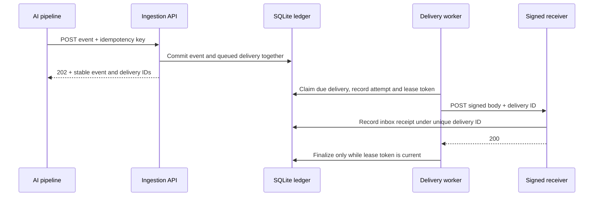

# RunLedger · AI event delivery console

An AI pipeline has finished. Its callback endpoint is returning 503. RunLedger stores the completion event, schedules delivery, records each attempt and lets an operator replay the dead letter after the endpoint recovers.


[Mobile delivery view](docs/dashboard-mobile.png) · [Mobile batch-replay audit](docs/dashboard-replay-mobile.png)

## Run the failure demo

From this directory, with Node.js 24 installed:

```sh
node server.mjs
```

Open [127.0.0.1:4327](http://127.0.0.1:4327). Set the receiver to **Down**, then select **Emit AI completion event**. Open the delivery and watch four attempts end in a dead letter. Switch the receiver to **Healthy** and choose **Replay delivery**. The same delivery ID succeeds in generation 2. Generation 1 remains in the timeline. **Transient** mode returns one 503 per delivery and then accepts a retry.

## How a delivery survives failure



| Boundary | Design decision |
| --- | --- |
| Producer → ledger | SQLite WAL and `BEGIN IMMEDIATE` make event creation and queue insertion one commit. A repeated key with an equivalent canonical payload returns the original IDs. A changed payload under the same key returns HTTP 409. |
| Ledger → worker | Claim and attempt creation share a short transaction. Network I/O happens after commit. An expired lease becomes an audit row and releases the job for a new attempt if its budget remains. A stale token cannot finalize the new attempt. |
| Worker → receiver | The raw request body, stable delivery ID and timestamp are signed with HMAC-SHA256. The receiver checks the signature and five-minute timestamp window before recording a receipt under a unique ID. If the receiver commits and its acknowledgment is lost, a retry can reach it again with the same ID. Its inbox suppresses the duplicate effect. |
| Retry → operator | Timeouts, connection errors, 408, 429 and 5xx use exponential backoff with equal jitter, capped at 10 seconds. `Retry-After` is a separate minimum wait, accepted as seconds or an HTTP date; it can extend the wait up to 24 hours. Longer values enter dead letter for operator review instead of retrying early. Terminal errors and exhausted budgets also enter the dead-letter view. Replay increments the generation and leaves old attempts intact. |

The console and demo receiver bind to loopback. SQLite stores the queue, lease, attempt history and receiver inbox on one machine. Search and status filtering run against the whole ledger. Pages use a `(created_at, id)` cursor, including a deterministic tie-break for simultaneous submissions. Each response reads global counts, filtered counts and its page in one SQLite read transaction. The demo persists under `data/runledger.sqlite` by default.

## Reproduce the evidence

```sh
node --test
node verify-workload.mjs
node verify-lookup.mjs
```

- **99 passing scenarios** cover idempotency conflicts, lease fencing, replay history, inbox persistence, a hard-killed worker process, live HTTP recovery, raw-body signature checks, a lost acknowledgment, preserved-history archives, signed artifact manifests, indexed lookup plans, bounded verification-cache freshness, archive checkpoints, transactional payload compaction, signed database activation, retry scheduling, queue measurements and real HTTP transport boundaries.
- **200 local HTTP submissions** ran in batches of 20 with two worker loops. The 100 repeated submissions returned their existing IDs. All 100 distinct events were delivered and recorded by the receiver.
- **A real process exit** leaves the winning claim in SQLite. A fresh connection reclaims it under a different token and rejects the stale completion.
- **A lost acknowledgment** produces two HTTP attempts and one committed inbox record. The second receipt increments the duplicate counter.
- **An old dead letter** remains discoverable behind 130 newer records. Cursor tests traverse tied timestamps exactly once while a newer event is inserted.
- **A real HTTP 429 with `Retry-After: 120`** schedules at least 120 seconds into the future while another queued delivery succeeds. The test inspects the persisted schedule without waiting two minutes.

The verification script uses a temporary database. The latest local run used Linux and Node.js 24.22.1. The [CI workflow](../.github/workflows/verify.yml) runs the same checks on Linux and Windows with Node.js 24; inspect its run result separately from local verification.

For the browser regression, run `npm ci` and `npx playwright install chromium` from the repository root, then `node scripts/verify_runledger_browser.mjs`. It checks pagination over 131 deliveries, an old dead letter, out-of-order search responses, replay history, empty results and a 390-pixel viewport. `CHROMIUM_EXECUTABLE` can select an installed browser. The CI browser job runs this check separately from the dependency-free Node.js suites.

## API

| Endpoint | Purpose |
| --- | --- |
| `POST /api/events` | Submit `{"type":"ai.run.completed","payload":{"run":"r-1"}}` with a unique `Idempotency-Key`. |
| `GET /api/overview` | Read global queue counts, filtered delivery pages and receiver counters. Supports `status`, `q`, `limit` and `cursor`. |
| `GET /api/metrics` | Read an uncached snapshot of queue health, attempt outcomes and latency populations. |
| `GET /api/deliveries/:id` | Read the event and attempt history. |
| `POST /api/deliveries/:id/replay` | Start a new attempt generation for a dead delivery. |

`status` defaults to `all` and accepts `queued`, `in_flight`, `delivered` or `dead`. `q` is a literal substring of event type, event ID or delivery ID (ASCII case-insensitive, up to 128 characters). `limit` defaults to 25 and accepts 1–100. The response's `page` contains `matching`, `limit`, `has_more` and `next_cursor`.

Pass `next_cursor` unchanged with the same status, query and limit. Changing those parameters starts a new traversal; incompatible or malformed cursors return HTTP 400. Newer insertions do not shift the next page. This is a live view: status changes can move deliveries into or out of a filtered result between requests. **Newest** restarts traversal to show fresh results; **Previous** reuses the prior page cursor.

## 中文导览

RunLedger 用 AI 任务完成回调展示事件投递的完整链路。写入事件和待投递任务是同一笔事务。worker 领取任务时写入租约和尝试记录，旧 worker 的完成请求无法覆盖新租约。接收端验签后用唯一投递 ID 写入 inbox。接收方已经处理但响应丢失时，后续投递可以安全识别重复。

控制台可以切换接收端故障模式、查看每次尝试，并在恢复后重放死信。运行 `node --test` 可复现进程退出、签名篡改和响应丢失。运行 `node verify-workload.mjs` 可复现并发重复提交验证。

## Design references

RunLedger is an independent portfolio implementation. Its delivery semantics draw on [Hook0's explanation of delivery guarantees](https://github.com/hook0/hook0/blob/master/documentation/explanation/webhook-delivery-guarantees.md). The lease and attempt model was compared with [LiteQueue](https://github.com/litements/litequeue) and [Hookrail](https://github.com/mit112/hookrail). The demo uses the symmetric signing format described in the [Standard Webhooks specification](https://github.com/standard-webhooks/standard-webhooks/blob/main/spec/standard-webhooks.md).

The `Retry-After` minimum-wait behavior follows [RFC 9110 §10.2.3](https://www.rfc-editor.org/rfc/rfc9110.html#name-retry-after). The 24-hour automatic retry limit and equal-jitter backoff are local application policies.

## Operational measurements

`GET /api/metrics` returns an uncached JSON snapshot of delivery status totals, attempt outcomes, due work, scheduled work, the age of the oldest due task and expired worker leases. The snapshot uses one SQLite read transaction. Attempt totals retain failed generations after replay, while delivery totals represent current state. Reading metrics does not reclaim expired leases; workers perform that transition when claiming work.

The console shows due work, scheduled work, oldest due age and expired leases alongside the existing status counters. These measurements describe this single-machine demo; they are not an availability SLO or a production monitoring deployment.

The HTTP transport regressions exercise 429 recovery with the same delivery ID, terminal 400 responses, redirects that must not be followed, bounded request timeouts and a receiver's 120-second `Retry-After` minimum without waiting two minutes in the test.

## Latency definitions

Open **Inspect delivery latency** in the console, or call `GET /api/metrics`. Measurements are computed on demand, not by every one-second overview poll. All three populations include sample counts, excluded negative-clock sample counts, min/mean/max and exact nearest-rank p50/p95/p99 in milliseconds. Empty populations return null durations rather than an artificial zero. SQLite computes the percentiles inside the same read transaction as the other metrics.

| Population | Start | End and inclusion |
| --- | --- | --- |
| `attempt` | Attempt claim timestamp | Finished attempts across all generations, including failed and expired attempts |
| `event_to_delivery` | Original event/queue creation timestamp | Successful completion for currently delivered events; includes queue waits, backoff and operator delay before replay |
| `generation_to_delivery` | First claim in the successful current generation | That generation's successful completion; includes retry waits after its first claim, excludes its initial queue wait and earlier generations |

Lease-expired attempt durations include the time until reclamation; they are not a network round-trip measurement. These are single-host wall-clock observations. Negative differences are excluded and counted; positive clock adjustments cannot be detected from these timestamps. Metrics scan retained history and are intended for this local demonstration, not high-volume telemetry.

The [recorded local workload](docs/verification-workload.json) contains its observation time, runtime, concurrency, sample counts and latency summaries. Reproduce with `node verify-workload.mjs`; different hosts and runs will produce different timings. The workload is a correctness and measurement exercise, not a production latency SLO or throughput benchmark.

## Backup and recovery

Run from this directory with Node.js 24. Backup, restore, repack, manifest and retired-source outputs use new paths:

```sh
node maintenance.mjs backup --source data/runledger.sqlite --output backups/ledger.sqlite
node maintenance.mjs restore --source backups/ledger.sqlite --output data/recovered.sqlite
node maintenance.mjs repack --source data/runledger.sqlite --output maintenance/compacted.sqlite
node maintenance.mjs sign-manifest --artifact maintenance/compacted.sqlite --output maintenance/compacted.manifest.json --secret-file backups/manifest.key
# Stop RunLedger before the activation step.
node maintenance.mjs activate-repack --source data/runledger.sqlite --candidate maintenance/compacted.sqlite --manifest maintenance/compacted.manifest.json --secret-file backups/manifest.key --retired maintenance/pre-repack.sqlite
```

Backup uses Node.js's [SQLite online backup API](https://nodejs.org/download/release/v24.0.0/docs/api/sqlite.html#sqlitebackupsourceDb-path-options). A read transaction pins one committed snapshot while WAL writers continue. The resulting standalone file includes committed WAL pages, events, deliveries, leases, all replay generations and inbox receipts. Changes committed after the pinned snapshot are outside its recovery point. A long read snapshot can keep WAL pages alive until copying finishes.

The tool opens the source read-only, checks SQLite integrity, required RunLedger columns and foreign keys, and validates the staged copy again. It closes the standalone copy in DELETE journal mode, syncs the file, then publishes with an exclusive hard link. Existing output files, output sidecars and source-sidecar aliases are rejected. Staging is on the destination filesystem and is removed after success or failure. Filesystems without hard-link support fail instead of falling back to partial publication. This is atomic file-name publication, not a universal power-loss durability guarantee.

The JSON result includes SHA-256, byte/page counts and snapshot row counts. The checksum identifies the produced file; it is not a signature or encryption. Use trusted local snapshots and protect them like the ledger itself. No live database is replaced. To switch the demo after a restore, stop the old app and start it with `RUNLEDGER_DB` pointing to the new database, retaining the signing secret required by your receiver.

An in-flight task retains its original lease and can be reclaimed after expiry; a stale token cannot complete the reclaimed task. Restored inbox entries still suppress duplicate receipts. This demonstrates recovery of the captured single-machine state. Delivered-history archiving is available as a separate read-only operation; source cleanup remains an explicit future policy.

Recovery tests include uncheckpointed WAL, replay and inbox persistence, lease reclamation, a concurrent writer, competing publishers, existing-target protection, malformed databases, foreign-key corruption and the CLI round trip.

`repack` uses SQLite `VACUUM INTO` against a read-only connection to produce a new compact candidate from one committed snapshot. It validates the source first, validates the candidate and its foreign keys, requires zero output free-list pages, switches the candidate to standalone DELETE-journal mode, file-syncs it and publishes through an exclusive hard link. The JSON result records SHA-256, row counts, source/output page observations and their logical byte delta. It also verifies that the source path still names the same file identity before publication. The live database path stays unchanged; perform any switchover through the explicit stop-and-restore procedure above.

Repack tests carry uncheckpointed WAL state, idempotency, latency populations, archive checkpoints, compaction receipts and event mappings into the candidate. Fault cases cover malformed sources, path aliases, existing targets and competing publishers. Source page observations can change across concurrent workloads, and logical page deltas describe this snapshot rather than durable storage savings. Directory fsync, encrypted storage and secure erasure remain deployment-specific operations.

`activate-repack` closes the maintenance loop for a stopped ledger. It authenticates the candidate manifest, copies and file-syncs the candidate on the source filesystem, checkpoints the source WAL and requires DELETE-journal mode. It then hashes every user schema object and every typed value in every table in deterministic order. Activation proceeds only when the source and candidate logical-state digests match and the candidate has zero free-list pages.

The predecessor is first published at the new `--retired` path through an exclusive hard link. A rename then replaces the source path atomically on the same filesystem. The activated file is re-inspected and its SHA-256 and logical digest are checked again; a validation failure restores the retired source automatically. The result records the previous and activated checksums, manifest checksum, logical-state checksum, verified table/row counts and `rollback_ready`. Keep the application stopped for this command and start it only after success. The original signed candidate stays available, and the retired path is a directly usable rollback database. Source drift after candidate creation, an open source connection, candidate sidecars, signature changes, path aliases, existing rollback targets and competing activations all stop publication.

### Signed offline artifact manifests

Keep a high-entropy key separately from the database and its manifest:

```sh
openssl rand -out backups/manifest.key 32
chmod 600 backups/manifest.key
node maintenance.mjs sign-manifest --artifact backups/ledger.sqlite --output backups/ledger.manifest.json --secret-file backups/manifest.key
node maintenance.mjs verify-manifest --artifact backups/ledger.sqlite --manifest backups/ledger.manifest.json --secret-file backups/manifest.key
```

The signed JSON binds the artifact basename, type, exact byte count, SHA-256 and inspection metadata. Backup manifests include ledger row counts. Archive manifests also include the exclusive cutoff, all table counts, identity contract and latency population definitions. Signing rechecks SQLite integrity and foreign keys, observes one stable file identity while hashing, file-syncs staging and publishes the manifest through an exclusive hard link. Verification authenticates the canonical manifest with HMAC-SHA256 before comparing the selected file and re-inspecting its schema and metadata.

The secret file accepts 32–4,096 raw bytes and symbolic-link inputs are rejected. Artifact, manifest and secret identities must remain distinct, including hard-link aliases. Tests cover content and metadata edits, wrong keys, renamed-file substitution, weak keys, aliases and competing manifest publishers. HMAC is symmetric: anyone holding the key can create a valid manifest. Store the key through a separate trusted channel. The manifest authenticates integrity and provenance within that trust boundary; it provides neither encryption nor public-key attribution.


## Retention preview and preserved-history archive

```sh
node maintenance.mjs retention-plan --source data/runledger.sqlite --before 1793491200000
node maintenance.mjs archive --source data/runledger.sqlite --output archives/delivered.sqlite --before 1793491200000
node verify-archive.mjs --deliveries 500
```

`--before` is an exclusive UTC epoch-millisecond completion cutoff (the example is 2026-11-01T00:00:00Z). The plan command reports candidate delivered records, their attempt-row count and logical UTF-8 payload bytes in one read transaction. The archive command pins the same eligibility snapshot and creates a standalone SQLite file. The cutoff uses the successful completion in the current generation, so a recently replayed old event stays in the source-only population until its latest success crosses the boundary. Missing or unfinished attempt history is excluded. Queued, in-flight and dead-letter work remains source-only.

Each archive preserves eligible event IDs, idempotency keys/digests, delivery rows, every attempt generation, matching inbox receipts and complete replay-operation receipts that touch an included delivery. A mixed replay receipt can therefore mention another delivery that remains source-only. Archive metadata records counts, the strict cutoff, identity contract and exact nearest-rank latency populations. The file is integrity- and foreign-key-checked, file-synced and published through an exclusive hard link; competing writers produce one winner. Legacy ledgers that predate operation receipts remain readable.

The source transaction is read-only and retains every row, so duplicate submissions, receiver deduplication, live metrics and operator history continue unchanged. Archive creation establishes a verifiable preservation boundary. Logical payload bytes from the preview do not predict reclaimed SQLite file size. Signed checkpoint registration is available before source cleanup; physical cleanup remains a separate policy and command.

The [recorded archive workload](docs/archive-workload.json) generated 500 completed source deliveries, including 50 dead-letter replays. Its strict midpoint cutoff archived 250 deliveries, 275 attempt generations, 63 inbox receipts and 25 replay-operation receipts. The script reopens the standalone file, checks its rows, integrity, foreign keys, metric contract and SHA-256, then confirms the source metrics and idempotent submission still match. The record contains local environment and timing scope; Linux/Windows CI runs a 100-delivery variant.

### Verified cross-file history lookup

Pair each archive with its signed manifest. Repeat both options in the same order for up to 20 archives:

```sh
node maintenance.mjs locate-history \
  --source data/runledger.sqlite \
  --archive archives/2026-10.sqlite \
  --archive-manifest archives/2026-10.manifest.json \
  --secret-file backups/manifest.key \
  --id delivery-or-event-or-idempotency-key
```

The command performs exact matching on delivery ID, event ID or idempotency key. Three index-directed branches use the primary/unique indexes in both the active ledger and each archive, then merge at most three candidates. A query-plan regression rejects scans of either base table and also verifies that one record matching two identity fields is returned once. The command validates the active ledger, authenticates and re-inspects every archive, observes stable artifact identity through lookup, then returns one logical match with every active/archive location. Artifact checksum and manifest creation time accompany archive locations. Identical copies merge by delivery ID; any difference in identity, type, timestamps, status, generation or attempt counters raises a conflict. Empty results still report how many archives were verified.

Long-lived callers can share a bounded verification cache while keeping every lookup's file-identity guard:

```js
const verificationCache = createArchiveVerificationCache({
  maxEntries: 20,
  ttlMs: 60_000,
});

await locateHistory({
  sourcePath,
  archivePairs,
  secretPath,
  query,
  verificationCache,
});
```

The in-process LRU coalesces concurrent verification for the same archive/manifest/key tuple and reuses a successful result within its TTL. Every hit compares absolute path, device, inode, size, modification time and change time for the archive, manifest and secret key. The same observations are repeated after the archive query. Expiry, eviction or any identity/metadata change triggers full HMAC, SHA-256, SQLite integrity, foreign-key and metadata verification; a rejected verification is removed immediately. Each result reports request-level hit, miss, coalesced and bypassed counts. A one-shot CLI invocation starts with a cold cache.

The [recorded lookup workload](docs/lookup-workload.json) uses 20,000 active deliveries, four signed copies of a 10,000-row archive and 1,000 probes per database. On that local Linux/Node.js 24 run, prepared-query p50 measured 0.007 ms for the active ledger and 0.006 ms for the archive. A lookup through four archives measured 97.99 ms with cold verification and 29.63 ms with identity-checked warm entries, a 3.3x difference in that run. Reproduce and refresh the report with `node verify-lookup.mjs --output docs/lookup-workload.json`; CI uses a smaller 2,000-row fixture with the same four-archive default and asserts index-directed plans on Linux and Windows.

### Signed archive checkpoints

Register a preservation checkpoint only after producing and signing the archive:

```sh
node maintenance.mjs checkpoint-archive \
  --source data/runledger.sqlite \
  --archive archives/2026-10.sqlite \
  --archive-manifest archives/2026-10.manifest.json \
  --secret-file backups/manifest.key
node maintenance.mjs list-checkpoints --source data/runledger.sqlite
```

Registration authenticates the manifest and observes stable archive and manifest identities. Under one `BEGIN IMMEDIATE` source transaction it compares every archived event, delivery, attempt, inbox receipt and replay-operation receipt against the source, including nullable fields. A differing or missing row rolls back the registration. A matching archive writes its artifact SHA-256, manifest SHA-256, signed cutoff, signed row counts and registration time to `archive_checkpoints`. The artifact hash is the idempotency key: concurrent processes produce one record, while repeated registration revalidates every source row before returning the original checkpoint. Online backup and restore carry this table with the ledger.

This checkpoint is durable evidence that the signed archive matched one locked source snapshot. Source rows remain present and live metrics keep their current populations.

### Checkpointed payload compaction

After checkpoint registration, compact larger completed-event payloads in the source ledger:

```sh
node maintenance.mjs compact-payloads \
  --source data/runledger.sqlite \
  --archive archives/2026-10.sqlite \
  --archive-manifest archives/2026-10.manifest.json \
  --secret-file /secure/runledger-archive.key
node maintenance.mjs list-checkpoints --source data/runledger.sqlite
```

The command reauthenticates and re-inspects the signed archive, requires its recorded manifest hash, takes a source `BEGIN IMMEDIATE` lock and repeats the full row comparison. It then replaces only archived payloads larger than `{"_runledger_archived":true}` with that canonical marker. Event and delivery IDs, idempotency keys and digests, all attempt generations, inbox receipts, replay-operation receipts, timestamps and exact latency populations remain unchanged. Smaller payloads remain byte-for-byte intact.

The payload updates, per-event archive mappings and one compaction receipt commit in the same transaction. The receipt records scanned and changed event counts plus logical UTF-8 bytes before and after. A trigger-induced mid-update failure rolls back the complete batch. Concurrent processes return one new receipt and one revalidated duplicate result. Online backup retains both tracking tables, and later retention plans and archives skip mapped events so the marker cannot replace original history in a newer archive.

Logical bytes describe live payload values. The `repack` command can materialize a compact, independently validated candidate after compaction. SQLite WAL lifecycle, live-file switchover and secure erasure remain explicit operational steps. The signed archive remains the source for original payload retrieval.


## Dispatch operations

The console can pause and resume dispatch while ingestion continues. A pause takes effect at the next transactional claim; current HTTP requests finish normally. Queued retries and replayed dead letters retain their due timestamps and generations. Expired leases remain visible during pause and are reclaimed with token fencing after resume. The control state persists across restarts and WAL backup/restore. Older databases initialize with running dispatch.

`GET /api/dispatch` returns `{paused, revision, updated_at}`. `POST /api/dispatch` accepts `{paused: true, expected_revision: 0}` with `Content-Type: application/json`. Matching revisions authorize a state transition; stale revisions return HTTP 409 with a refresh instruction. Same-state requests preserve the revision. Overview and metrics include the dispatch state in their existing read transactions. The console refreshes its state after each control action.


## Audited replay operations

Select dead letters with the table checkboxes or select the dead letters on the current page. A selection can span pages and contain up to 50 records. **Replay selected** queues the whole selection in one transaction after checking every current status and expected generation. A stale selection returns HTTP 409 and preserves every target. Single-delivery replay in the console uses the same operation API.

`POST /api/replays` accepts `{operation_key: "operator-request-1", deliveries: [{id: "<delivery UUID>", generation: 1}]}`. A new operation returns HTTP 202 with a stable `action_id`, `replayed_count` and each generation transition. Retry the same operation key and targets to receive HTTP 200 with `duplicate: true`, including after the deliveries finish. Reordering the same targets preserves operation identity. A changed selection under a recorded key returns HTTP 409.

The console saves an outstanding request in tab session storage. After a lost response or page reload, **Retry replay request** resends that key and reads the durable receipt. The audit panel and `GET /api/actions?limit=20` expose recent operations, their keys, targets and timestamps. Limits range from 1 to 100. Operator receipts survive restart and backup/restore; the original single-delivery HTTP endpoint retains its prior contract.

The audit identifies local operations in this loopback demonstration. User identity and multi-tenant authorization remain future deployment work. Keep operation keys, results and earlier attempt generations with the corresponding delivery history when defining retention.
